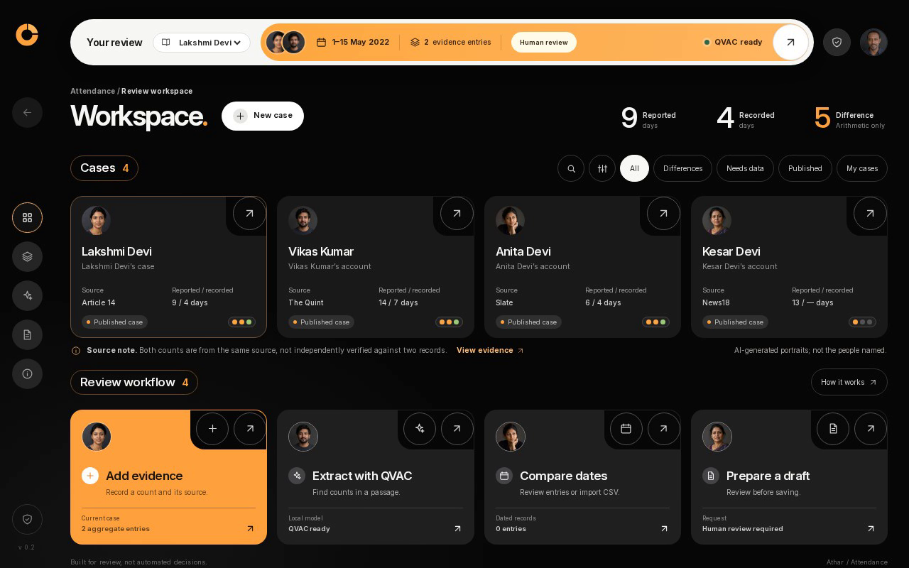

# Athar Attendance

**When a workday disappears from the record, the evidence should not depend on a connection.**

[](https://docs.qvac.tether.io/sdk/js-ts-sdk/)
[](https://huggingface.co/QuantFactory/Qwen2.5-1.5B-Instruct-GGUF)
[](https://nodejs.org/)
[](#verification)
[](LICENSE)

Athar is a local-first workspace for **reviewing attendance evidence**. It uses QVAC and a local language model to suggest day counts and supporting quotations from a passage. A person checks the source, assigns the meaning and decides what to record. After the initial setup, the core workflow does not need internet access.

[Watch the narrated demo](evidence/Athar_Narrated_Demo.mp4) · [Offline proof](evidence/offline-proof.json) · [Quick start](#quick-start) · [Architecture](docs/ARCHITECTURE.md) · [Sources](docs/SOURCES.md) · [العربية](docs/README_AR.md)



> The portraits are AI-generated illustrations, not photographs of the people named in the reports. The examples are attributed historical reporting, not independently authenticated original records.

## The problem

Attendance discrepancies can be difficult for workers and advocates to document, especially when connectivity is unreliable. In one [Article 14 report](https://tribe.article-14.com/post/nrega-workers-are-losing-wages-because-of-mandatory-app-attendance--62c39de7b5d3d), a paper roll showed nine days and the electronic record showed four. Those figures come from **one published account**; Athar does not possess the original rolls or independently verify them. Other historical examples and their limitations are in [Sources](docs/SOURCES.md).

Athar organizes information for review. It does **not** determine wages or legal entitlement, authenticate records, modify a government system, or submit a complaint. A numerical difference is a prompt to investigate, not proof of an unpaid wage.

## How it works

1. **Collect:** create a case or inspect an attributed published example. Enter counts or import dated CSV rows after reviewing them.
2. **Extract locally:** QVAC runs Qwen2.5 on the local CPU and proposes up to two counts with exact quotations from a supplied passage.
3. **Review:** deterministic checks match quotations and numeric tokens, but cannot verify meaning or authenticity. A person classifies each candidate before adding it.
4. **Compare and draft:** review known, missing and duplicate information; edit a request for review and explicitly confirm it before download. Nothing is sent automatically.

Browser case storage and exported files are **unencrypted**. Use a trusted device and do not enter private data without permission. See [Security and privacy](SECURITY.md).

## Demo and offline evidence

The [narrated demo](evidence/Athar_Narrated_Demo.mp4) opens with the problem statement and then shows a real automated browser recording. The English voice-over is AI-generated; the opening graphics and captions were added after recording. The QVAC inference is retained **in full, without cuts or speed-up**.

On 30 October 2026, the Linux x64 test placed the browser, app server and QVAC worker in one network namespace with only loopback and no IPv4 routes. Live command outputs are displayed in a browser-rendered transcript before and after inference; an outbound TCP attempt returned `ENETUNREACH` both times. This proves isolation of the **app environment**, not that the host's Wi-Fi switch was off.

The local model proposed **9** and **4**, with the quotations `nine days` and `four days`, in **36.910 seconds** on a CPU with two threads. This is one observed example, not an accuracy benchmark. See the [machine-readable proof](evidence/offline-proof.json), [raw recording](evidence/Athar_Offline_Recording.webm), and [test notes](evidence/DEMO_TEST_RESULTS.md).

## Quick start

**Tested:** Linux x64, Node.js 22.23.4, CPU. **Target only:** Windows 10/11 x64 has not been tested; QVAC documents Vulkan 1.4+ on Windows, including CPU usage. Install [Node.js 22.17 or newer](https://nodejs.org/) and system `tar`. QVAC recommends at least 4 GB RAM; allow at least 6 GB free disk. The default model is about 986 MB and dependencies occupied about 2.4 GB on the tested Linux system.

An internet connection is needed once to install dependencies and download the model:

```bash
git clone https://github.com/AbdullahBalfaqih/QVAC-Hackathon.git
cd QVAC-Hackathon
node scripts/install-locked.mjs
node scripts/download-model.mjs
node server.mjs
```

Open **http://127.0.0.1:4174** on the same device and wait for `QVAC ready`. After setup, inference works offline; opening linked external articles still requires a connection. The model and `node_modules` are not in the repository. If dependencies are already installed, skip the installer: it refuses to overwrite `node_modules`.

[Windows commands, optional smaller model, configuration and CSV format](docs/SETUP.md)

## Verification

| Check | Observed result | Scope |
| --- | --- | --- |
| Unit and server tests | 12 / 12 passed | Linux, `npm test` |
| Browser workflow | 35 checks passed | Includes real QVAC extraction for two published examples |
| Reference UI | 53 checks passed | Filtering, images and responsive widths |
| Offline inference | 9 and 4 in 36.910 s | One passage; loopback-only app namespace |

The full results and limitations are in [`evidence/`](evidence/). Windows, GPU acceleration, field deployment, recovered wages and broad model accuracy have **not** been tested.

```bash
npm test
```

To reproduce the Linux network-isolated recording after installing Python Playwright, Chromium and `iproute2`, with user/network namespaces enabled:

```bash
MODEL_PATH="$PWD/models/Qwen2.5-1.5B-Instruct.Q4_K_M.gguf" ./scripts/offline-demo.sh
```

The script fails rather than claiming offline proof if the isolation checks fail. See [setup and reproducibility](docs/SETUP.md).

## Repository structure

```text
.
├── server.mjs                 Local HTTP server and QVAC integration
├── public/                    English interface, logic, portraits and fonts
│   ├── app.js                 UI and review workflow
│   ├── core.mjs               Validation and evidence comparison
│   ├── avatars/               Disclosed fictional illustrations
│   └── fonts/                 Locally bundled, licensed fonts
├── scripts/                   Installer, model download, demo and UI checks
├── tests/                     Node unit and server tests
├── docs/                      Setup, architecture, sources and submission notes
│   └── assets/dashboard.png   Screenshot from the real offline recording
├── evidence/                  Narrated demo, raw recording and test results
├── SECURITY.md                Privacy and threat boundaries
├── CONTRIBUTING.md            Contribution and verification guidance
└── LICENSE                    MIT licence for the project code
```

## Technology and credits

| Component | Role |
| --- | --- |
| [QVAC by @tetherto](https://github.com/tetherto/qvac) | Local AI SDK, version 0.22.0 |
| [Qwen2.5 by @QwenLM](https://github.com/QwenLM/Qwen2.5) | Underlying language model family |
| [QuantFactory GGUF](https://huggingface.co/QuantFactory/Qwen2.5-1.5B-Instruct-GGUF) | Qwen2.5-1.5B-Instruct Q4_K_M model distribution |
| Inter and Noto Sans Arabic | Locally bundled fonts, SIL OFL |

Maintained by [@AbdullahBalfaqih](https://github.com/AbdullahBalfaqih). Upstream projects and sources are credited without implying endorsement. The code is [MIT licensed](LICENSE); QVAC, the model, fonts and dependencies retain their respective licences. See [sources and asset provenance](docs/SOURCES.md) and [submission disclosures](docs/AI_YAKO_SUBMISSION.md), including prior work.
